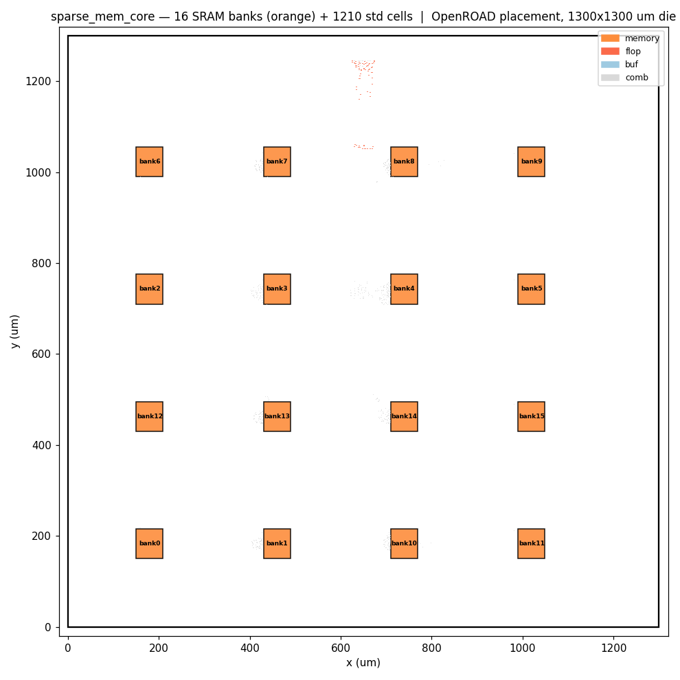

# sparse_mem_core — a multi-memory example for def2graph

A synthetic **16-bank sparse memory core** (loosely an AI-inference scratchpad
array) used to exercise def2graph's **memory-boundary** handling at scale. It is
*not* a faithful accelerator model — it's a connectivity scaffold that produces
the right graph structure: many memory macros reached from ports both
combinationally and through flops, with read data flowing back to output ports.



16 `fakeram45_64x32` SRAM banks (orange) placed in a 4×4 grid by OpenROAD, with
~1,210 Nangate45 std cells of glue logic.

## Files

| File | What it is |
|---|---|
| `gen.py` | Generator — emits the structural Verilog netlist (edit `NBANKS` to scale) |
| `sparse_mem_core.v` | Generated gate-level netlist (16 banks + 1,210 cells) |
| `place.tcl` | OpenROAD placement-only script (floorplan → manual macro grid → global/detailed place → `write_def`) |
| `sparse_mem_core_placed.def` | The placed DEF — ready-to-use def2graph input |
| `placement.png` | Floorplan figure above |

## Structure

- Registered address/write-data (`DFF`) fan out to all 16 banks → port→flop→mem paths.
- Combinational per-bank select/enable (`bank_sel` decode → `we`/`ce`) → port→mem paths.
- Masked OR-reduction read path to a **combinational** output (`rdata_c`, so output
  ports reach `mem_dout`) and a **registered** output (`rdata_r`).

## Reproduce

```bash
# 1. regenerate the netlist (optional; sparse_mem_core.v is included)
python3 gen.py

# 2. place it with OpenROAD (needs the Nangate45 PDK + fakeram45 LEF/LIB and an
#    openroad binary; this DEF was produced via the OpenROAD/test Nangate45 files).
#    Run place.tcl from a dir where Nangate45/*.lef|lib are visible, writing to /work.
openroad -exit place.tcl        # or inside a container, see place.tcl header
```

## Run def2graph on it

```bash
python -m def2graph \
  --def sparse_mem_core_placed.def \
  --lef /path/to/Nangate45_tech.lef /path/to/Nangate45_stdcell.lef /path/to/fakeram45_64x32.lef \
  --lib /path/to/Nangate45_typ.lib /path/to/fakeram45_64x32.lib \
  --out out/sparse_mem
```

Expected: `fakeram45_64x32` classified as **memory** (LEF `CLASS BLOCK` + Liberty
`memory()`), **16/16 banks** detected as boundaries, and **624 memory endpoints**
(input ports → `we_in`/`ce_in`/`clk`; output ports ← `rd_out`), each carrying its
placement coordinate. See the project README for the graph schema and outputs.
